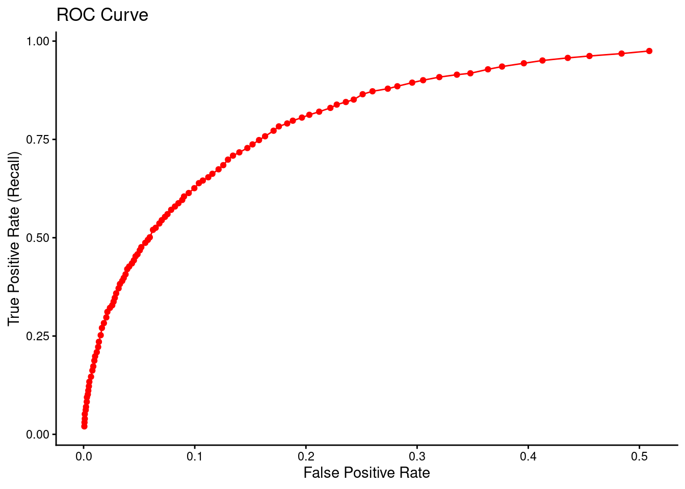
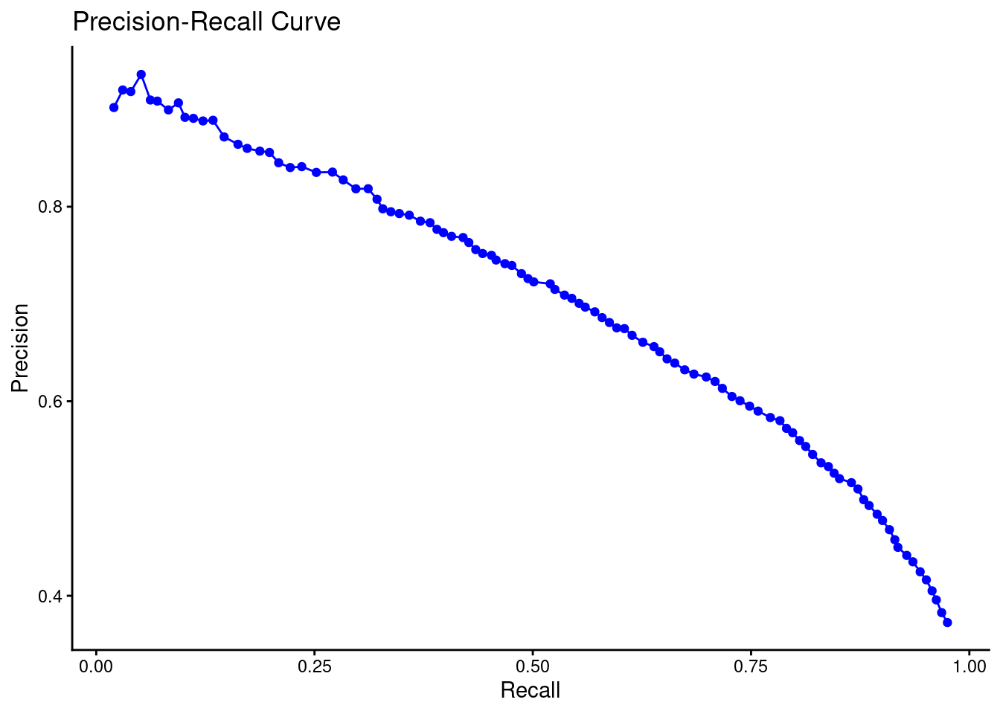

# m6APrediction

## Introduction

**m6APrediction** is an R package designed to predict RNA N6-methyladenosine (m6A) modification sites using a pre-trained Random Forest machine learning model.

The package provides functions for processing DNA sequence features and predicting m6A modification probabilities and classification statuses based on multiple RNA-related features.

The package provides three main functions:

-   `dna_encoding()`: converts DNA sequences into position-specific categorical factors.

-   `prediction_multiple()`: predicts m6A probabilities and Positive/Negative statuses for multiple samples in a data frame.

-   `prediction_single()`: predicts the m6A probability and status for one sample using individually supplied feature values.

## Installation

The package can be installed directly from GitHub using `devtools` or `remotes`.

First, install the required package:

```         
install.packages("devtools")
```

Then install m6APrediction from GitHub:

```         
devtools::install_github("congg51781/m6APrediction")
```

Alternatively, you can use `remotes`:

```         
install.packages("remotes")
remotes::install_github("congg51781/m6APrediction")
```

Load the package:

```         
library(m6APrediction)
```

## Example Data

The package includes two example data files stored in `inst/extdata/`:

-   **`rf_fit.rds`**: a fitted Random Forest model used for m6A prediction.

-   **`m6A_input_example.csv`**: an example data frame containing the RNA-related input features required by the prediction functions.

These files allow users to try the prediction functions without having to train a new model or prepare their own example dataset.

## Usage

### Load the fitted model

First, load the package and the fitted Random Forest model included with it:

```         
library(m6APrediction)

ml_fit <- readRDS(
  system.file("extdata", "rf_fit.rds", package = "m6APrediction")
)
```

### 1. Multiple Sample Prediction

`prediction_multiple()` accepts a data frame containing the seven required input features. It returns the original input data with two additional columns: `predicted_m6A_prob` and `predicted_m6A_status`.

```         
example_df <- read.csv(
  system.file("extdata", "m6A_input_example.csv", package = "m6APrediction")
)

multiple_results <- prediction_multiple(
  ml_fit = ml_fit,
  feature_df = example_df,
  positive_threshold = 0.6
)

head(multiple_results)
```

The `positive_threshold` argument sets the decision threshold. A sample is classified as `Positive` when its predicted positive-class probability is greater than the threshold; otherwise, it is classified as `Negative`.

### 2. Single-sample prediction

The `prediction_single()` function predicts the m6A probability and classification status for an individual sample.

```         
single_result <- prediction_single(
  ml_fit = ml_fit,
  gc_content = 0.6,
  RNA_type = "mRNA",
  RNA_region = "CDS",
  exon_length = 12,
  distance_to_junction = 5,
  evolutionary_conservation = 0.8,
  DNA_5mer = "GGACA",
  positive_threshold = 0.5
)

print(single_result)
```

The function returns a named vector containing:

-   `predicted_m6A_prob`: Predicted m6A probability.

-   `predicted_m6A_status`: Predicted classification status.

## Model Performance

The predictive performance of the Random Forest model was evaluated in Practical 4 using Receiver Operating Characteristic (ROC) and Precision-Recall Curve (PRC) analysis.

### ROC Curve



### Precision-Recall Curve



These curves provide visual assessments of the model's ability to distinguish between positive and negative m6A samples.

## Author

Shunran Wang

Email: [Shunran.Wang24\@student.xjtlu.edu.cn](mailto:Shunran.Wang24@student.xjtlu.edu.cn)

## License

MIT License. See the `LICENSE` file for details.
